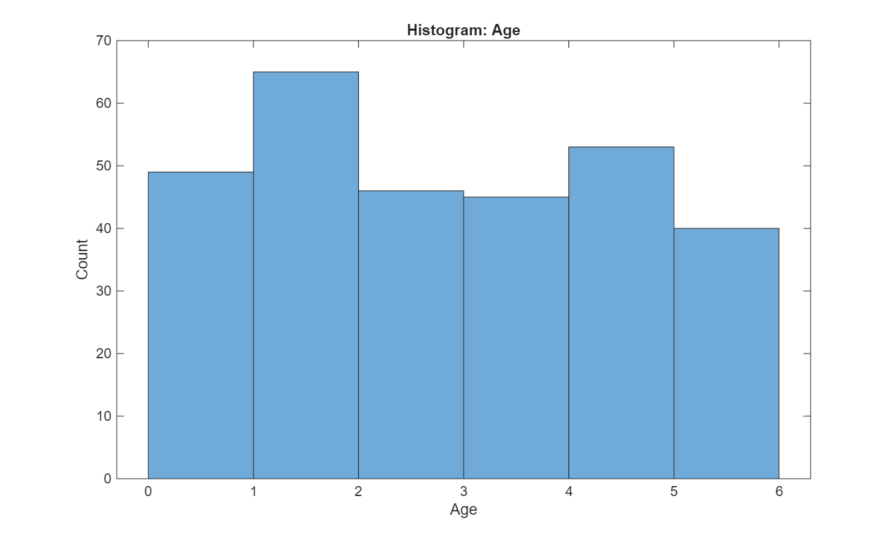
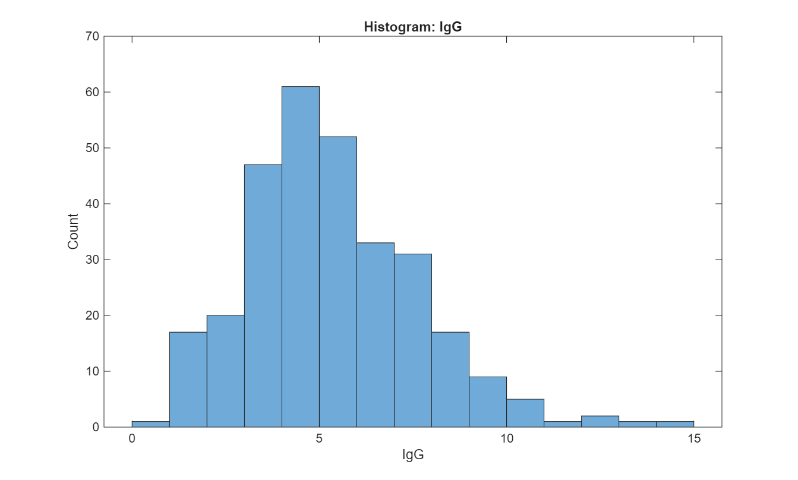

# Homework 1: OLS vs. ML, Binary and Ordered Choice

📄 [Problem set](assignment/HW1-questions.pdf) · 📘 [Full solutions (PDF)](report/HW1-solutions.pdf) · 💻 [Code](code/)

| Question | Topic | Script |
|:--:|---|---|
| Q1 | IgG vs. age: OLS, quadratic model, Newton–Raphson MLE | [`Q1_igg.m`](code/Q1_igg.m) |
| Q2 | Recoding the Pew marijuana-legalization survey | [`Q2_data_prep.m`](code/Q2_data_prep.m) |
| Q3 | Binary probit and covariate effects | [`Q3_probit.m`](code/Q3_probit.m) |
| Q4 | Binary logit and comparison with probit | [`Q4_logit.m`](code/Q4_logit.m) |
| Q5 | Ordinal probit for educational attainment | [`Q5_ordinal_probit.m`](code/Q5_ordinal_probit.m) |

Run everything with `run('HW1/code/run_all.m')`. Q4 reads the prepared data that Q2 writes to `HW1/output/`.

---

## Q1: Immunoglobulin-G and age (n = 298)

**Descriptive statistics**

| Variable | Mean | Median | SD | Max | Min | Skewness |
|---|---:|---:|---:|---:|---:|---:|
| IgG | 5.2923 | 5.0000 | 2.2769 | 14.4 | 0.9 | 0.7685 |
| Age | 2.7740 | 2.5833 | 1.6647 | 6.0 | 0.5 | 0.2662 |

  
  

IgG is right-skewed. Age is close to uniform over 6 months to 6 years.

**OLS and ML estimates**

| Term | Model 1 (OLS) | Model 2 (OLS) | Model 2 (MLE, σ = 1) |
|---|---:|---:|---:|
| Intercept | 3.3640 (0.2210) | 3.0839 (0.3820) | 3.0839 (0.1951) |
| Age | 0.6951 (0.0684) | 0.9675 (0.3107) | 0.9675 (0.1587) |
| Age² | | −0.0455 (0.0506) | −0.0455 (0.0258) |
| R² | 0.2583 | 0.2603 | |

Standard errors are in parentheses. Each extra year of age raises mean IgG by about 0.70 g/L, and age explains about 26% of the variation. The quadratic term is negative but insignificant. The ML point estimates match OLS exactly. The SEs differ because the question fixes the error variance at 1.

## Q2: Data preparation (n = 1,240)

| Variable | Categories (count, %) |
|---|---|
| y (support legalization) | No: 581 (46.9%) · Yes: 659 (53.1%) |
| Past use | No: 653 (52.7%) · Yes: 587 (47.3%) |
| Sex | Female: 637 (51.4%) · Male: 603 (48.6%) |
| Parent | No: 882 (71.1%) · Yes: 358 (28.9%) |
| Marital status | Single: 235 (19.0%) · Post-married: 285 (23.0%) · Couple: 720 (58.1%) |
| Income | Poor: 642 (51.8%) · Middle: 366 (29.5%) · Rich: 232 (18.7%) |
| Education | ≤ HS: 414 (33.4%) · < Bachelor's: 381 (30.7%) · ≥ Bachelor's: 445 (35.9%) |
| Race | White: 954 (76.9%) · Black: 146 (11.8%) · Other: 140 (11.3%) |
| Party | Democrat: 422 (34.0%) · Republican: 357 (28.8%) · Independent/Other: 461 (37.2%) |

Age has mean 50.50 (SD 17.76), and household size has mean 2.72 (SD 1.44).

## Q3 & Q4: Binary probit and logit

$$\Pr(y_i=1\mid x_i)=F(x_i'\beta),\qquad \ell(\beta)=\sum_i \big[y_i\ln F(x_i'\beta)+(1-y_i)\ln(1-F(x_i'\beta))\big]$$

with $F=\Phi$ for probit and $F=\Lambda$ for logit.

| Term | Probit β (t) | Logit β (t) |
|---|---:|---:|
| Intercept | 0.522 (1.94) | 0.857 (1.93) |
| Age | −0.009 (−3.09) | −0.015 (−3.05) |
| Household size | −0.061 (−1.83) | −0.100 (−1.81) |
| **Past use** | **0.800 (10.19)** | **1.305 (10.03)** |
| Male | 0.165 (2.10) | 0.267 (2.05) |
| Parent | 0.043 (0.41) | 0.078 (0.45) |
| Single | 0.121 (1.00) | 0.196 (0.97) |
| Post-married | 0.052 (0.49) | 0.086 (0.49) |
| Poor | −0.188 (−1.57) | −0.299 (−1.50) |
| Middle income | −0.179 (−1.56) | −0.282 (−1.48) |
| HS and below | −0.174 (−1.74) | −0.296 (−1.78) |
| Less than bachelor's | 0.078 (0.79) | 0.123 (0.75) |
| White | −0.040 (−0.32) | −0.070 (−0.34) |
| Black | −0.314 (−1.97) | −0.518 (−1.96) |
| Democrat | 0.226 (2.42) | 0.366 (2.36) |
| **Republican** | **−0.474 (−4.95)** | **−0.784 (−4.94)** |

| Covariate effect on Pr(y = 1) | Probit (average) | Logit (at the mean) |
|---|---:|---:|
| Age + 5 years | −0.0155 | −0.0184 |
| Being a parent | 0.0146 | 0.0138 |

Past use, party affiliation, age and sex drive support for legalization. The logit coefficients are about 1.6 times the probit ones, as expected from the different error scales, while the implied probability effects are close.

## Q5: Ordinal probit for educational attainment (n = 3,923)

$$\Pr(y_i=j)=\Phi(\kappa_j-x_i'\beta)-\Phi(\kappa_{j-1}-x_i'\beta),\qquad \kappa_0=-\infty,\ \kappa_4=\infty$$

| Term | Coef. | SE | t |
|---|---:|---:|---:|
| √famIncome | 0.140 | 0.010 | 13.61 |
| educMother | 0.050 | 0.008 | 6.53 |
| educFather | 0.072 | 0.006 | 11.49 |
| motherWorked | 0.032 | 0.036 | 0.89 |
| female | 0.164 | 0.035 | 4.69 |
| black | 0.152 | 0.044 | 3.45 |
| urban | −0.043 | 0.043 | −1.01 |
| south | 0.055 | 0.038 | 1.44 |
| age15 | −0.027 | 0.054 | −0.50 |
| age16 | 0.005 | 0.054 | 0.09 |
| age17 | 0.230 | 0.056 | 4.09 |

The hit-rate is 0.435 and McFadden's R² is 0.0885.

**Average effect of +$10,000 family income:** ΔP(y=1) = −0.0391, ΔP(y=2) = −0.0098, ΔP(y=3) = +0.0157, ΔP(y=4) = +0.0332.

> **Note on the intercept.** The model includes an intercept and leaves all three cut-points free, so the intercept and κ₁ are not separately identified. The intercept estimate and its SE are therefore not meaningful (see the report). The slope coefficients and probability effects are unaffected. Fixing κ₁ = 0, or dropping the intercept, would remove the problem.
