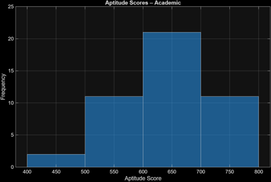
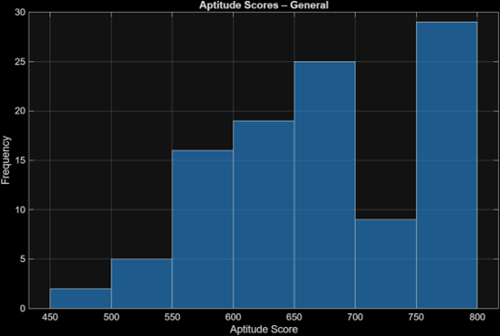
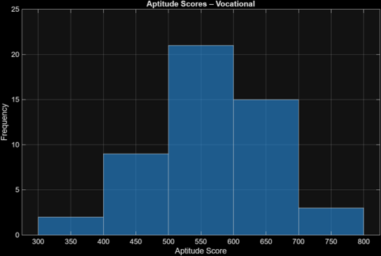
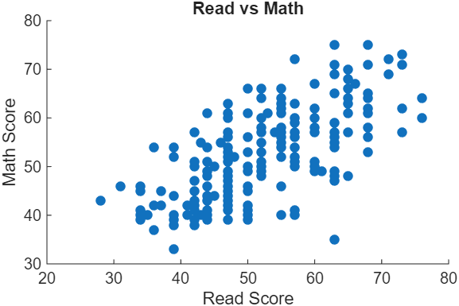
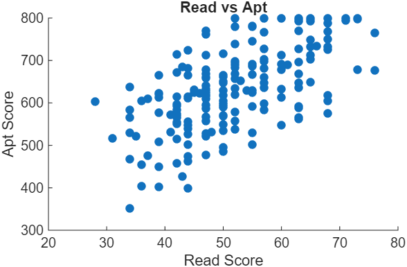
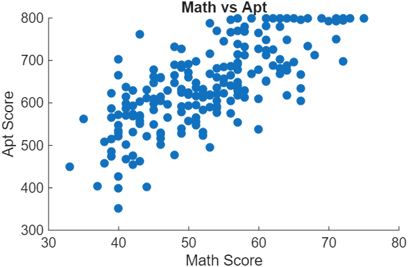
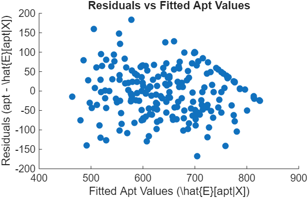
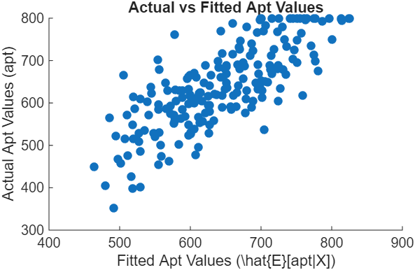

# Homework 3: Censoring, Truncation, Sample Selection and Treatment Effects

📄 [Problem set](assignment/HW3-questions.pdf) · 📘 [Full solutions (PDF)](report/HW3-solutions.pdf) · 💻 [Code](code/)

| Question | Topic | Script |
|:--:|---|---|
| Q1 | Exponential duration model under truncation vs. censoring | analytical (see report) |
| Q2 | Tobit Type I for aptitude scores censored at 800 | [`Q2_tobit.m`](code/Q2_tobit.m) |
| Q3 | Women's hours of work: OLS, Heckman two-step, robust and bootstrap SEs, FIML | [`Q3_heckman.m`](code/Q3_heckman.m) |
| Q4 | Job training and earnings: endogenous treatment-effect model | [`Q4_treatment_effect.m`](code/Q4_treatment_effect.m) |

Run everything with `run('HW3/code/run_all.m')`.

---

## Q1: Truncation vs. censoring

With $\mu_i=\exp(x_i'\beta)$, $f(y_i)=\mu_i^{-1}e^{-y_i/\mu_i}$ and $\Pr(Y_i>36)=\exp(-36e^{-x_i'\beta})$.

- **Truncated sample** (only workers with $y_i>36$ are observed): $\ln L=\sum_{i=1}^{\tilde n}\big[-x_i'\beta-(y_i-36)e^{-x_i'\beta}\big]$
- **Censored sample** ($x_i$ observed for everyone): $\ln L=\sum_{y_i>36}\big[-x_i'\beta-y_ie^{-x_i'\beta}\big]+\sum_{y_i\le 36}\ln\big(1-e^{-36e^{-x_i'\beta}}\big)$

## Q2: Tobit Type I

| Program | n | % |
|---|---:|---:|
| Academic | 45 | 22.5 |
| General | 105 | 52.5 |
| Vocational | 50 | 25.0 |

  
  
  

  
  
  

In the plots against `apt`, the observations pile up in a horizontal band at 800, which is the right-censoring point.

| Variable | Coef. | SE | t |
|---|---:|---:|---:|
| Intercept | 209.570 | 32.774 | 6.39 |
| read | 2.698 | 0.619 | 4.36 |
| math | 5.915 | 0.710 | 8.33 |
| general | −12.715 | 12.407 | −1.02 |
| vocational | −46.144 | 13.724 | −3.36 |

The average partial effects on observed `apt` are +2.50 per reading point and +5.48 per maths point. Vocational students score about 46 points lower than academic students.

  
  

## Q3: Sample selection in women's hours (Mroz)

| | (a) OLS, all | (b) OLS, hours > 0 | (e) Two-step | (f) Robust SE | (g) Bootstrap SE | (h) FIML |
|---|---:|---:|---:|---:|---:|---:|
| Intercept | −20.68 | 1143.9 | 2094.6 | 2112.4 | 2094.6 | 1632.7 |
| educ | 31.14* | −21.02 | −25.81 | −26.74 | −25.81 | −24.05 |
| exper | 42.90* | 28.88* | 5.46 | 5.08 | 5.46 | 17.30* |
| hhours | −0.034 | 0.022 | −0.030 | −0.029 | −0.030 | −0.008 |
| λ (IMR) | | | −797.7* | −801.5* | −797.7* | |
| SE(λ) | | | 201.47 | 198.81 | 251.92 | |

\* significant at 5%.

**Selection (probit / FIML) equation:** experience and older children raise participation. Young children (`kidsl6`) and the marginal tax rate lower it. FIML gives **ρ = −0.506 (t = −4.52)** and σ = 788.98, which confirms that participation and hours share unobserved factors. OLS on working women alone is therefore inconsistent. The IMR has mean 0.716 and variance 0.117.

## Q4: Does job training raise earnings? (jtrain2, n = 445)

| | Trained | Not trained |
|---|---:|---:|
| Share of sample | 41.6% | 58.4% |
| Mean 1978 earnings ($000) | 6.35 | 4.55 |
| Unemployed in 1978 | 24.3% | 35.4% |

The raw gap is about $1,790 in earnings and 11 percentage points in unemployment. Participation was not randomised, so a treatment-effect model is estimated by FIML:

$$T_i^*=x_{1i}'\beta_1+\varepsilon_{1i},\quad y_i=x_{2i}'\beta_2+\alpha T_i+\varepsilon_{2i},\quad (\varepsilon_{1i},\varepsilon_{2i})\sim N\!\left(0,\begin{pmatrix}1&\sigma_{12}\\ \sigma_{12}&\sigma_2^2\end{pmatrix}\right)$$

| Parameter | Estimate | SE | t |
|---|---:|---:|---:|
| **α (training effect)** | **1.194** | 2.943 | 0.41 |
| ρ | 0.048 | 0.282 | 0.17 |
| σ | 6.444 | 0.223 | 28.96 |
| σ₁₂ = ρσ | 0.309 | | |

The point estimate says training adds about $1,200 to 1978 earnings, but the estimate is very imprecise and not significant. ρ ≈ 0, so there is little evidence of selection on unobservables. The full coefficient tables are in the report.
